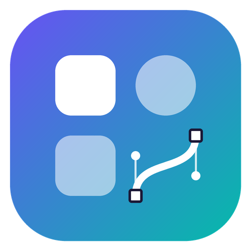

<h1 align="center">CEUTEC Ingeniería en Informática</h1>

Comunidad de estudiantes para aprender a construir apps y diseñar pantallas, haciendo.

> Esta no es una cuenta oficial de CEUTEC ni de UNITEC. Es una comunidad estudiantil, con logo y material propios.

## Qué es esto

Un lugar para aprender Flutter, Dart y diseño de interfaces con proyectos de verdad. La idea es simple: leés un poco, hacés una app o una pantalla, la subís en un pull request y el check te dice en verde si pasa. Si te trabás, preguntás y alguien de la comunidad te echa la mano.

No seguimos el temario de ninguna clase. Aquí se aprende armando cosas.

## Empezá por aquí

| Repo | Para qué te sirve |
|---|---|
| [`cursos-gratis`](https://github.com/CEUTEC-Ingenieria-en-Informatica/cursos-gratis) | Cursos oficiales y gratis por ruta (Flutter, diseño, web, IA, nube, Git, inglés técnico, certificaciones). Cada enlace se comprueba |
| [`flutter-de-cero-a-app`](https://github.com/CEUTEC-Ingenieria-en-Informatica/flutter-de-cero-a-app) | De Dart básico a una app completa, con ejercicios que se corrigen solos con `flutter test` |
| [`diseno-ui-ux-para-devs`](https://github.com/CEUTEC-Ingenieria-en-Informatica/diseno-ui-ux-para-devs) | Color, tipografía, espaciado, Material 3, accesibilidad y cómo pasar de Figma a Flutter |
| [`retos-ui-flutter`](https://github.com/CEUTEC-Ingenieria-en-Informatica/retos-ui-flutter) | Retos de pantallas con diseños originales. Hacés la tuya y la comparás con la de los demás |

¿No sabés por dónde arrancar? Abrí `cursos-gratis`, elegí la ruta de Flutter y Dart, y cuando tengas tu primera app corriendo pasate a `flutter-de-cero-a-app`.

## Cómo aportar

1. Encontraste un error, un enlace caído o algo confuso: abrí un issue con el formulario "Error en el material".
2. Conocés un curso bueno y gratis: usá "Proponer curso" en `cursos-gratis`.
3. Tenés una idea de reto o de tema: usá "Proponer reto" o "Proponer curso".
4. Querés corregirlo vos: hacé un fork, cambiá lo que haga falta y abrí un pull request. La guía completa está en [CONTRIBUTING](https://github.com/CEUTEC-Ingenieria-en-Informatica/.github/blob/main/CONTRIBUTING.md).

Antes de participar leé el [código de conducta](https://github.com/CEUTEC-Ingenieria-en-Informatica/.github/blob/main/CODE_OF_CONDUCT.md). Es corto.

## Quién está detrás

El material lo escribe James V ([@Dio77799](https://github.com/Dio77799)), estudiante de Ingeniería en Informática. Cualquiera de la comunidad puede corregirlo y sumar lo suyo con un pull request.

## Sobre el uso de IA

El material se arma con ayuda de IA y la comunidad lo revisa. Cada ejercicio trae pruebas que se corren de verdad y cada enlace se comprueba antes de publicarlo. Si algo no cuadra, avisá en un issue y se corrige.

## Sobre el logo

El logo es propio: un icono de app con tres mosaicos y, en el cuarto, la curva de la pluma de un editor de diseño. No usa el escudo, el nombre ni los colores oficiales de la universidad. El SVG, el PNG y el script que los dibuja están en [`profile/marca/`](https://github.com/CEUTEC-Ingenieria-en-Informatica/.github/tree/main/profile/marca).
